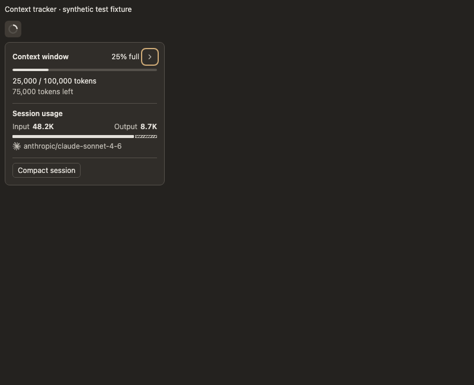

# Hermes Context Tracker

**See what fits now and what the conversation has used so far.** A small ring in the top-left toolbar of Hermes Desktop follows the focused chat.

- **Hover** for context used, capacity and remaining tokens.
- **Click** to pin the panel and see session input/output and the current model. Click again, click outside, or press Escape to dismiss.
- Expand **What fills the window?** for estimated context categories. Use **Compact session** to summarize older context in that conversation.

The ring is **current context occupancy**. Session input/output are cumulative Hermes-reported counts across model switches, not context occupancy or a per-model bill. The current model label doesn’t attribute all those tokens to that model. `?` means unavailable, not empty. The meter fill stops at 100%, but the panel still reports overages.

## Install

In **Capabilities → Plugins → Install from Git**, paste `https://github.com/mu1ze/hermes-context-tracker` and choose **Desktop**. Or download a [release ZIP](https://github.com/mu1ze/hermes-context-tracker/releases) and put `plugin.js` in `$HERMES_HOME/desktop-plugins/context-tracker/` (normally `~/.hermes/desktop-plugins/context-tracker/`). If needed, use **Reload desktop plugins** in the command palette.

Requires Hermes Desktop with the titlebar and focused-session SDK and a gateway with `session.context_breakdown` for categories and `session.compress` for compaction. No separate backend, account, or build step. Disable it in **Capabilities → Plugins**, or remove the manually installed folder.

## Compaction and privacy

Compaction is explicit and only targets the focused session on its owning gateway. It may use model tokens and has no undo in this plugin. The button is disabled during turns, when the session gateway cannot be reached safely, and while compaction is pending or unconfirmed. The tracker does not auto-retry this action. If a request times out, check the conversation before retrying; reloading the plugin clears its in-memory guard.

The plugin reads usage metadata through the existing Desktop SDK. It does not persist conversation contents, read credentials, or call external URLs. As with other Desktop plugins, it runs with [app authority](https://hermes-agent.nousresearch.com/docs/developer-guide/desktop-plugin-sdk#security-model).

## Tests

With Node.js 22+: `npm ci`, `npx playwright install chromium`, then `npm test`. Linux CI uses `npx playwright install --with-deps chromium`.

Tests run the plugin with React, React Query, Radix and a small SDK fixture. They cover the compact overview, disclosure, live and unknown states, overages, focus and gateway isolation, compaction responses, and light/dark contrast. Screenshots and compaction responses in tests are synthetic, not live account data.

MIT · Independent community plugin.
