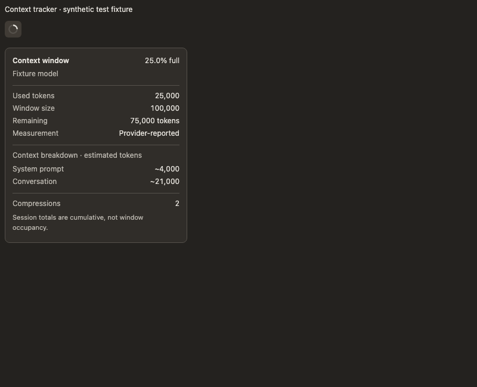
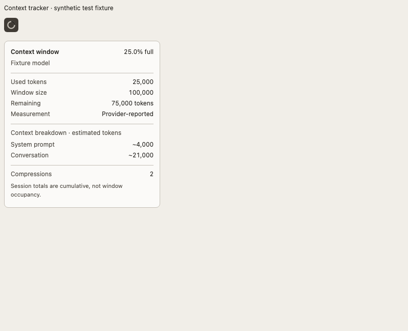

# Hermes Context Tracker

A small context-window ring in the **top-left toolbar of Hermes Desktop**. Hover or focus it to see the current conversation's context details. Its tooltip follows your app theme, including custom theme colors.




The screenshots are browser fixtures with synthetic values, not account usage.

## Features

- Ring fills with `context_used / context_max`, not cumulative session input/output.
- Follows the focused conversation, including tiled chats.
- Streams occupancy during turns and refreshes the detailed breakdown when idle.
- Shows used/max tokens, remaining capacity, model, estimated category breakdown, compressions and session totals when reported.
- Distinguishes estimates, a real zero and unavailable data (`?`).
- Uses Hermes theme tokens for the ring, tooltip, arrow, borders and text.
- Supports keyboard focus and accessible meter labels.
- No Python backend, credentials, external account calls or production dependencies.

## Requirements

Hermes **Desktop**, not the web dashboard or CLI alone. This release needs the Desktop SDK's `TITLEBAR_AREAS.left`, `Tip`, `useQuery` and focused-session atoms, plus a gateway exposing `session.context_breakdown`. Compatibility is API-based; no minimum app version has been established. Older gateways can still show streamed occupancy when it is available, but may lack a breakdown.

## Install from a release ZIP

1. Extract the ZIP.
2. Create `$HERMES_HOME/desktop-plugins/context-tracker/` (normally `~/.hermes/desktop-plugins/context-tracker/`).
3. Copy **only `plugin.js`** into that folder.
4. Hermes hot-loads the plugin. If needed, use the command palette's **Reload desktop plugins** command.

The folder must be named `context-tracker`, matching the plugin's ID. Desktop plugins are app-level; you do not need a separate copy for every connected profile or remote gateway. Do not copy `node_modules`, tests or package metadata to install it. Node/npm are needed only for development, not installation.

### Install from Git

Open **Capabilities → Plugins → Install from Git**, paste this repository URL and select the **Desktop** target:

```text
https://github.com/mu1ze/hermes-context-tracker
```

No agent/backend installation is required. Enable **Context tracker** if it is off after installing.

Install link for websites and supported URL handlers:

```text
hermes://plugin/install?repo=mu1ze/hermes-context-tracker&enable=1
```

A link does not bypass the app's installation confirmation.

### Update or uninstall

For manual installations, replace `plugin.js` with the new release; saves hot-reload. For Git installations, use the app's update/rescan controls. Disable it in **Capabilities → Plugins**; remove the `context-tracker` folder to uninstall a manual copy. Avoid installing both a manual and Git-managed copy with the same ID.

## What the numbers mean

The ring measures current context occupancy. Session input/output are cumulative accounting totals and are shown separately, never added to the ring. A provider-reported prompt count and an estimated category breakdown are different measurements; estimate labels preserve that distinction. Capacity and counts come from Hermes, not an independently queried provider catalog.

During a turn, the tooltip can show live occupancy without categories. Categories refresh after the turn. If the gateway is disconnected or has not reported context, the ring shows `?` rather than pretending the window is empty. Percent fill is visually capped at 100%; raw token counts are not hidden.

## Privacy and trust

This plugin reads focused-session state and calls the existing gateway RPC `session.context_breakdown`. It does not fetch external URLs, read credentials, persist conversation contents or mutate sessions. The tooltip displays token metadata, not the text of your system prompt or messages.

Hermes Desktop plugins execute with app authority: review source code before installing any plugin. This plugin's lack of a backend is not a sandbox/security guarantee. See the [official SDK security model](https://hermes-agent.nousresearch.com/docs/developer-guide/desktop-plugin-sdk#security-model).

## Develop and test

Node.js 22+ and npm:

```sh
npm ci
npx playwright install chromium
npm test
```

On Linux CI, use `npx playwright install --with-deps chromium`.

Tests bundle the real plugin with React and React Query and a small SDK adapter. They cover placement, the context RPC, hover details, live updates, estimate labels, session isolation, unknown/zero/over-capacity values, and dynamic dark/light theme contrast (at least 4.5:1 for small text). Screenshots are regenerated in `screenshots/`. The SDK tooltip fixture explicitly reproduces native inverted defaults so incorrect theme overrides fail the test.

These tests do not boot Electron or prove compatibility with every Desktop release. Smoke-test the actual app when upgrading SDK dependencies.

No build step is needed for `plugin.js`. Its only runtime imports are the app-provided SDK and React JSX runtime. `package.json` is private to prevent accidental npm publication; the distributable is the plugin source, not an npm runtime package.

```sh
npm run pack
```

This creates an npm-format tarball containing the plugin, README, license and screenshots. A release ZIP can distribute the same source with the tests and lockfile for reproducibility.

## License

MIT. Independent community plugin; not an official Nous Research release.
